

  

  
  
  <a href="https://valb-blog.vercel.app/">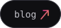</a>
  <a href="https://www.linkedin.com/in/valb-mig/">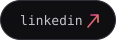</a>
  <a href="https://www.instagram.com/valb.mig/">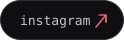</a>

 

<picture>
  <source media="(prefers-color-scheme: light)" srcset="assets/title-setup-light.svg">
  
</picture>


 

<picture>
  <source media="(prefers-color-scheme: light)" srcset="assets/title-projects-light.svg">
  
</picture>

  <a href="https://github.com/ato20-org/ato20">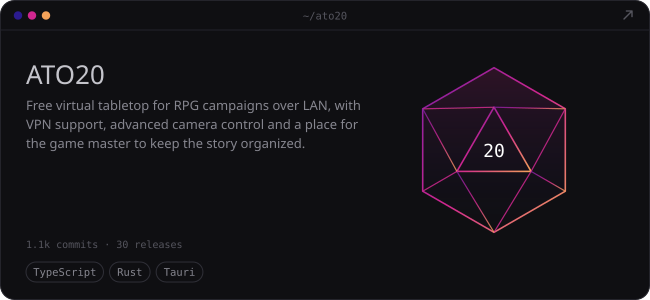</a>
  <a href="https://github.com/valb-mig/claude.remote">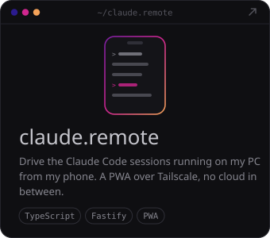</a>
   
  <a href="https://github.com/valb-mig/app.porto">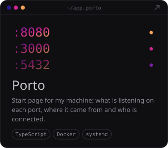</a>
  <a href="https://github.com/open-foco">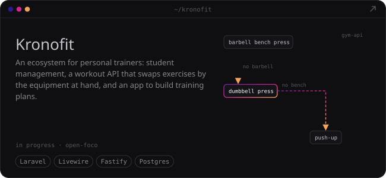</a>
   
  <a href="https://github.com/valb-mig/php.teller">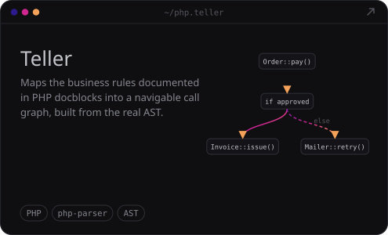</a>
  <a href="https://github.com/valb-mig/app.commitable">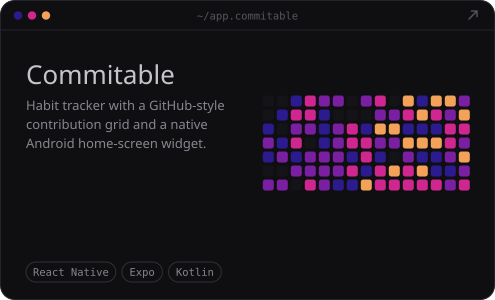</a>

<picture>
  <source media="(prefers-color-scheme: light)" srcset="assets/footer-light.svg">
  
</picture>
